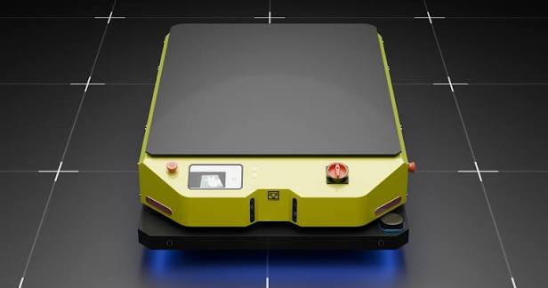
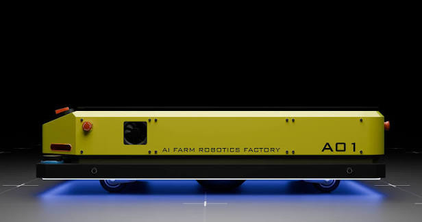

# Trailobot — Autonomous Mobile Robot

**Navigation:** [Robot Platforms](README.md) · **Trailobot** · [ABB IRB 1200](abb_irb1200_manipulator.md) · [RB3-1200](rb3_1200_manipulator.md) · [Simulation guide](../../../02_robot_simulation/trailobot_amr/README.md)

<table>
  <tr>
    <td align="center"></td>
    <td align="center"></td>
    <td align="center"></td>
  </tr>
</table>

<p align="center"><sub>Trailobot AMR — front, three-quarter, and side views (AI Farm Robotics Factory)</sub></p>

> **Source repository:** [github.com/boyloy21/Trailobot_Simulation](https://github.com/boyloy21/Trailobot_Simulation)
> **Inspected version:** branch `main`, commit `54dcda2` (September 2026)
> **License (repository):** MIT (repository `LICENSE`); individual `package.xml` files declare Apache-2.0

This course **references** the Trailobot implementation; it does not copy it. All facts below were taken from the repository files. Every statement is labelled:

| Label | Meaning |
| ----- | ------- |
| ✅ **Confirmed** | Present in the repository files (inspected) |
| 🧪 **Tested** | Checked by the course maintainers in the course environment (Ubuntu 24.04 · ROS 2 Jazzy · Gazebo Harmonic), as described |
| 📝 **Proposed** | Planned course activity, not yet implemented or tested |
| ⚠️ **Issue** | Mismatch or problem found during inspection |

---

## 1. What Trailobot Is

Trailobot is an indoor differential-drive AMR developed by AutobotX-LAB (AIFARM Robotics Factory). It is the course's main mobile-robot platform: students meet its software structure in Week 1, its robot description in Week 2, and use it for SLAM and navigation in Week 3.

## 2. Target Environment of the Repository

✅ The repository README states **ROS 2 Humble, Gazebo Fortress (Ignition), Ubuntu 22.04**. The Gazebo plugins in the model use Fortress-era names (`libignition-gazebo-*`).

⚠️ The course standard is **ROS 2 Jazzy + Gazebo Harmonic** on Ubuntu 24.04. Section 6 summarizes what works in the course environment and what needs porting.

## 3. Packages (✅ confirmed)

| Package                | Build type     | Contents (from the files)                                                                 |
| ---------------------- | -------------- | ----------------------------------------------------------------------------------------- |
| `trailobot_description` | `ament_cmake` | Xacro model (`urdf/robot.xacro` + 11 included files), STL meshes, worlds, Gazebo models, maps, RViz configs, Nav2/AMCL/EKF/SLAM/controller configs, launch files |
| `trailobot_launch`      | `ament_cmake` | Launch files: `mapping.launch.py`, `navigation.launch.py`, `status_sensor.launch.py`, `web_server.launch.py`; Nav2 parameter sets; maps |
| `trailobot_interfaces`  | `ament_cmake` | Service `srv/CancelNavigation.srv`                                                        |
| `trailobot_teleop`      | `ament_python` | Executable `ps4_node` (PS4 controller teleoperation)                                     |
| `trailobot_web`         | `ament_python` | Executables `sensor_status`, `imu_diagnostics`, `lidar_diagnostics`, `cancel_nav`        |

⚠️ The repository README also lists `ros2_laser_scan_merger`, `trailobot_sim.launch.py`, `slam.launch.py`, a `display.launch.py` in `trailobot_launch`, `teleop_key.py`, `web.launch.py`, and `docs/images/Trailobot.png`. **These are not in the repository.** Use the file list above, not the README, as the reference.

## 4. Robot Description (✅ confirmed from `urdf/const.xacro` and `urdf/robot.xacro`)

### 4.1 Main dimensions and masses

| Property                     | Value (Xacro property)                    |
| ---------------------------- | ----------------------------------------- |
| Base length × width × height | 1.2 m × 0.812 m × 0.388 m                 |
| Drive wheel radius / width   | 0.1 m / 0.25 m                            |
| Wheel separation             | 0.8 m (`wheel_separation`)                |
| Caster wheel radius          | 0.05 m                                    |
| Base mass / wheel mass       | 20.0 kg / 4.0 kg                          |
| LiDAR range                  | 0.15–7 m, 30 Hz, 360 samples              |

### 4.2 Frames and joints

```text
base_footprint
└── base_link                (base_joint: z = base_height/2 + wheel_radius)
    ├── chassis_link, cover_link, imu_link
    ├── left_wheel_link, right_wheel_link          continuous, axis 0 1 0
    ├── caster_fl/fr/bl/br_link                    fixed (4 casters)
    ├── LidarFR_link, LidarBL_link                 fixed (2 × 2D LiDAR)
    ├── CameraFR_link, CameraFL_link               fixed (2 × RGB-D camera)
    └── ultraFL/FR/LF/LB/BL/BR/RB/RF_link          fixed (8 × ultrasonic range sensor)
```

* ✅ Xacro argument `GAZEBO` (default `false`) switches between Gazebo plugins (`gazebo.xacro`) and a `ros2_control` hardware description (`ros2_control.xacro`).
* ✅ Sensors in the Gazebo configuration: IMU (`/imu`, 100 Hz), two `gpu_lidar` sensors on topics `scan_right` (LidarFR) and `scan_left` (LidarBL), two `rgbd_camera` sensors (5 Hz), eight ultrasonic `ray` sensors.
* ✅ Drive: Gazebo `DiffDrive` system on `/cmd_vel` with `wheel_separation` 0.8 m and `wheel_radius` 0.11 m (`wheel_radius + 0.01`).
* ⚠️ The four casters use **fixed** joints, so in simulation they act as rigid low-friction supports, not rolling wheels.
* ⚠️ The LiDAR topics are `scan_right`/`scan_left`, not the `scan_front`/`scan_rear` named in the repository README.

### 4.3 Launch files in `trailobot_description` (✅ confirmed)

| Launch file                      | What it starts (from the file)                                                |
| -------------------------------- | ------------------------------------------------------------------------------ |
| `visualization.launch.py`        | `robot_state_publisher` (from `robot.xacro`), `joint_state_publisher_gui`, RViz2 |
| `ign.launch.py`                  | Gazebo via `ros_gz_sim/gz_sim.launch.py` with `worlds/my_world.sdf`, spawn, `robot_localization` EKF, and a laser-scan merger launch from the external package `ros2_laser_scan_merger` |
| `trailobot_ign_spawn.launch.py`  | `robot_state_publisher` (`GAZEBO:=true`), `ros_gz_sim create`, `ros_gz_bridge` with `config/bridge_config.yaml` |
| `mapping.launch.py`              | SLAM Toolbox with `config/map_params_online_async.yaml`, map saver           |
| `nav2.launch.py`, `nav2_V2.launch.py`, `nav2_low_speed.launch.py` | Nav2 servers, AMCL, map server with maps in `map/`   |
| `display.launch.py`              | ⚠️ Default model `urdf/diff_drive2.xacro` **does not exist**; pass `model:=` explicitly or use `visualization.launch.py` |

## 5. Role in the Course

| Week | Use of Trailobot                                                                                     | Status |
| ---- | ---------------------------------------------------------------------------------------------------- | ------ |
| 1    | Example of a robot software structure (nodes, topics, launch files, packages); the lecture notes use it as a node-system example | ✅ lecture material exists |
| 2    | Real-world example of links, wheel joints, sensor frames, Xacro structure (`GAZEBO` argument, macros), and TF; compared with the lab robot `diffbot` in Exercise 12 | ✅ description validated (Section 6) · 📝 guided comparison |
| 3    | Main AMR platform for SLAM, localization, Nav2, and autonomous navigation in simulation              | 📝 proposed; depends on the Jazzy/Harmonic port (Section 7) |

## 6. Compatibility with the Course Environment (🧪 tested)

Tested in October 2026 with ROS 2 Jazzy and Gazebo Harmonic (gz-sim 8.10) from the RoboStack distribution, headless with software rendering. The repository was **not** built with `colcon`; files were processed directly.

| Check                                                   | Result |
| ------------------------------------------------------- | ------ |
| `xacro robot.xacro` with `GAZEBO:=false` and `GAZEBO:=true` | ✅ Generates URDF |
| `check_urdf`                                            | ✅ Valid; root `base_footprint`, 21 links under `base_link` |
| `gz sdf -p` (URDF → SDF)                                | ✅ Converts; warnings for Fortress-only sensor tags (`ignition_frame_id`, camera parameters) |
| Spawn in Gazebo Harmonic (`ros_gz_sim create`)          | ✅ Spawns. Fortress plugin names are remapped with deprecation warnings |
| Spawn into a world that also loads `Sensors`/`SceneBroadcaster` | ⚠️ Gazebo crashed. The model itself loads these world-level systems, so they are loaded twice |
| Spawn into a minimal world (physics + user commands only) | ✅ Runs; publishes `/scan_left`, `/scan_right`, `/imu`, depth-camera topics, and odometry; drives on `/cmd_vel` |
| LiDAR `frame_id` in Harmonic                            | ⚠️ `trailobot::base_footprint::LidarFR` (Gazebo-scoped name). `ignition_frame_id` is not used by Harmonic; `gz_frame_id` is needed for TF-correct scans |
| `OdometryPublisher` plugin (`libignition-gazebo6-…`)    | ⚠️ Fails to load in Harmonic (library not found) |
| Odometry topic in Harmonic                              | ⚠️ `/model/trailobot/odometry`; the bridge config expects `trailobot/odom` |
| Repository world `worlds/my_world.sdf`                  | ⚠️ Does not load: models are included with absolute paths to the author's home directory, and `model://grey_wall` does not match the `GreyWall` folder |
| `ign.launch.py`                                         | ⚠️ Requires the package `ros2_laser_scan_merger`, which is not in the repository |
| Bridge config (`bridge_config.yaml`)                    | Uses `IGN_TO_ROS` directions — not tested in this environment |
| Nav2 / SLAM / web / PS4 launch files                    | Not tested |
| Behavior on the original Humble + Fortress target       | Not tested |

## 7. Proposed Work Before Week 3 (📝)

To use Trailobot as the Week 3 platform on Jazzy + Harmonic, the repository (or a course fork) needs, at minimum:

1. Gazebo system names updated to Harmonic (`gz-sim-…-system`, `gz::sim::systems::…`); remove or replace the `odometry-publisher` system.
2. World-level systems (`Sensors`, `SceneBroadcaster`) moved from the robot model to the world files.
3. `ignition_frame_id` replaced by `gz_frame_id` with the TF link names (e.g. `LidarFR_link`).
4. World files made portable (`model://` URIs resolvable through `GZ_SIM_RESOURCE_PATH`, no absolute paths).
5. The laser-scan merger either added as a dependency with install instructions or removed from `ign.launch.py`.
6. The bridge configuration aligned with the actual Harmonic topic names; README updated to match the files.

These changes belong in the Trailobot repository, not in this course repository.

## 8. Related Documents

* [Trailobot simulation guide](../../../02_robot_simulation/trailobot_amr/README.md) — how to obtain and inspect the model
* [Week 2 — Kinematic Modeling & Simulation](../weeks/week02_kinematics_simulation/README.md)
* [Week 3 — SLAM & Navigation](../weeks/week03_slam_navigation/README.md)
* [Nav2 references](../../../04_references/nav2.md)
