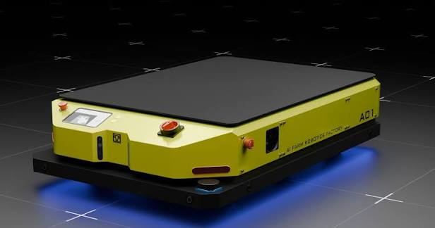

# Robot Simulation

**Navigation:** [Repository README](../README.md) · **Robot Simulation** · [Trailobot](trailobot_amr/README.md) · [ABB IRB 1200](abb_irb1200/README.md) · [RB3-1200](rb3_1200/README.md)

<table>
  <tr>
    <td align="center"></td>
    <td align="center"></td>
    <td align="center"></td>
  </tr>
</table>

<p align="center"><sub>Trailobot AMR · ABB IRB 1200 · RB3-1200</sub></p>

---

This folder explains how to **obtain, inspect, and run** the simulation of each course robot. The robot code itself stays in its original repository, so it is maintained in one place and keeps its own license. These guides tell you which repository, branch, and commands to use, and what has been verified.

| Robot | Guide | Implementation repository | Course status |
| ----- | ----- | ------------------------- | ------------- |
| Trailobot AMR | [trailobot_amr/](trailobot_amr/README.md) | [boyloy21/Trailobot_Simulation](https://github.com/boyloy21/Trailobot_Simulation) | Model inspection works on Jazzy; Gazebo Harmonic port needed for Week 3 |
| ABB IRB 1200 | [abb_irb1200/](abb_irb1200/README.md) | [IFRA-Cranfield/ros2_SimRealRobotControl](https://github.com/IFRA-Cranfield/ros2_SimRealRobotControl) (`jazzy`) | Model and FK verified on Jazzy; simulation/MoveIt launch not yet tested |
| RB3-1200 | [rb3_1200/](rb3_1200/README.md) | Not yet available | Waiting for a robot description |

The Week 2 teaching robot `diffbot` is not in this folder: students build it themselves, and its complete files are in the [Week 2 lab guide](../01_course_documentation/course/weeks/week02_kinematics_simulation/lab/lab_guide.md).

## Common Workflow for Any Robot

Before using a robot description in a lab, check it with the same steps students learn in Week 2:

```bash
xacro <robot>.urdf.xacro > /tmp/robot.urdf     # 1. generate URDF
check_urdf /tmp/robot.urdf                      # 2. validate the tree
gz sdf -p /tmp/robot.urdf 2>&1 | grep -iE "warn|error"   # 3. check how Gazebo will load it
ros2 run tf2_tools view_frames                  # 4. inspect TF (with the robot running)
```

## Environment

All guides assume the [course environment](../01_course_documentation/course/software_requirements.md): Ubuntu 24.04, ROS 2 Jazzy, Gazebo Harmonic. If a robot repository targets a different ROS or Gazebo version, its guide says so.
