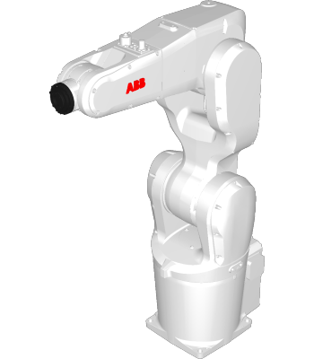

# ABB IRB 1200 — Simulation Guide

**Navigation:** [Robot Simulation](../README.md) · [Trailobot](../trailobot_amr/README.md) · **ABB IRB 1200** · [RB3-1200](../rb3_1200/README.md) · [IRB 1200 platform page](../../01_course_documentation/course/robot_platforms/abb_irb1200_manipulator.md)

<p align="center">
  
  <br><sub>ABB IRB 1200</sub>
</p>

> **Implementation repository:** [IFRA-Cranfield/ros2_SimRealRobotControl](https://github.com/IFRA-Cranfield/ros2_SimRealRobotControl), branch **`jazzy`** (inspected at commit `b8fa70d`), Apache-2.0
> Robot description: package `ros2srrc_robots`, folder [`ros2srrc_robots/irb1200`](https://github.com/IFRA-Cranfield/ros2_SimRealRobotControl/tree/jazzy/ros2srrc_robots/irb1200)

The IFRA-Cranfield framework is **not copied** into this course repository. It targets the same stack as the course: Ubuntu 24.04, ROS 2 Jazzy, Gazebo Harmonic, and MoveIt 2.

---

## 1. Install

Follow the repository's own guide, which is the authoritative source:
[`instructions/Installation.md` (branch `jazzy`)](https://github.com/IFRA-Cranfield/ros2_SimRealRobotControl/blob/jazzy/instructions/Installation.md).

In summary, it installs MoveIt 2, `ros2_control`/`ros2_controllers`, Gazebo Harmonic with the ROS pairing packages and `gz_ros2_control`, and CycloneDDS. It then clones the repository into a workspace:

```bash
cd ~/dev_ws/src
git clone -b jazzy https://github.com/IFRA-Cranfield/ros2_SimRealRobotControl
cd ~/dev_ws
colcon build
```

The installation guide also covers optional dependencies (ABB and UR drivers, grippers). For simulation-only course work, read the guide to decide which ones are needed.

## 2. Inspect the Robot Description (Weeks 2 and 4)

After building and sourcing the workspace:

```bash
cd /tmp
xacro $(ros2 pkg prefix --share ros2srrc_irb1200)/urdf/irb1200.urdf.xacro > irb1200.urdf
check_urdf irb1200.urdf
```

Expected (tested with the source files on Jazzy):

```text
root Link: world has 1 child(ren)
    child(1):  robot_stand
        child(1):  base_link
            child(1):  base
            child(2):  link_1
                ... link_6 → flange → tool0
```

Check forward kinematics at the zero pose. Terminal 1:

```bash
ros2 run robot_state_publisher robot_state_publisher /tmp/irb1200.urdf
```

Terminal 2:

```bash
ros2 topic pub -r 10 /joint_states sensor_msgs/msg/JointState \
  "{header: {stamp: now}, name: [joint_1, joint_2, joint_3, joint_4, joint_5, joint_6], position: [0, 0, 0, 0, 0, 0]}"
```

Terminal 3:

```bash
ros2 run tf2_ros tf2_echo base_link tool0
```

Expected (tested): `Translation: [0.533, 0.000, 0.889]`, `Rotation: in RPY (degree) [0.000, 90.000, 0.000]`.

## 3. Simulation and Motion Planning (Week 4)

The repository documents these launch commands in [`instructions/ROS2EnvironmentLaunch.md`](https://github.com/IFRA-Cranfield/ros2_SimRealRobotControl/blob/jazzy/instructions/ROS2EnvironmentLaunch.md):

```bash
# Gazebo simulation of a configuration
ros2 launch ros2srrc_launch simulation.launch.py package:=ros2srrc_irb1200 config:=irb1200_1

# Gazebo + MoveIt 2 (IRB 1200 with Schunk EGP-64 gripper)
ros2 launch ros2srrc_launch moveit2.launch.py package:=ros2srrc_irb1200 config:=irb1200_2
```

Available configurations (from `packages/ros2srrc_irb1200/config/configurations.yaml`):

| `config:=`  | Description                                          |
| ----------- | ---------------------------------------------------- |
| `irb1200_1` | ABB IRB-1200 on top of a robot stand                 |
| `irb1200_2` | ABB IRB-1200 + Schunk EGP-64 gripper on a robot stand |

> **Not yet tested by the course maintainers.** The Week 4 lab will confirm the exact workflow before it is published.

## 4. Real Robot

`bringup.launch.py` in the repository connects to a physical robot. Real-robot operation is **not** part of the course labs and needs supervision and the site's safety procedures.
